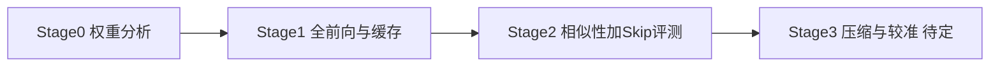

# VGGT 层间冗余分析与深度压缩（论文草稿）

> **投稿意向**：NeurIPS 2026（未定稿，仅供内部迭代）  
> **仓库说明**：实现与更完整文献表见本仓库 `docs/paper_related_work.md`、`REDUNDANCY_IMPLEMENTATION_SUMMARY.md` 等。

---

## 题目（待定）

**中文（建议）**：面向视觉几何基础模型的层间冗余分析及其深度压缩：以 VGGT 为例  

**英文（建议）**：Inter-Layer Redundancy Analysis and Depth Compression for Visual Geometry Transformers: A Case Study on VGGT  

---

## 摘要

前馈式多视图几何基础模型（如 VGGT）在精度上表现突出，但在长序列、多视角输入下面临显存与延迟压力。近期工作主要从 **token 合并**、**稀疏全局注意力** 与 **描述子化全局推理** 等角度缓解 **token 与算子层面** 的冗余，而 **网络深度方向** 上全局块（global block）等功能单元是否冗余、能否在保持几何指标的前提下系统删减，仍缺乏与下游位姿、稠密深度与点云几何评测 **直接对齐** 的分析与压缩范式。

本文以 VGGT 为对象，构建 **冗余性分析管线**：在 ScanNet 等数据上完成全场景前向 **状态缓存**，在统一几何评测口径下联合 **表征相似性**（如 CKA、余弦、负 MSE）与 **按层区间重放（suffix replay）后的 GT 指标变化**，量化层间/区间冗余并引出可复现观察。在此基础上，我们探索 **删减 aggregator 深度** 并结合 **LoRA 较准**（在有限场景上作参数高效适配，区别于全量微调）以恢复性能；**压缩结构、较准超参与完整实验数字仍在确定中**。

实验协议上，较准与测试数据划分及部分 benchmark **与 FastVGGT 等近期 VGGT 加速工作对齐**，对比 **原始 VGGT** 与 **FastVGGT**，并在 ScanNet 预留测试集以及 7Scenes、NRGBD 上报告标准几何与深度指标。本文强调与 token 级加速的 **互补性**：前者降低序列内计算冗余，本文聚焦 **深度/层级** 冗余的度量与消除路径。

---

## 1. 引言

多视图几何估计从优化驱动走向 **大规模前馈 Transformer**（如 VGGT），在相机位姿、稠密深度与三维点云等任务上达到强基线。VGGT 的聚合器（Aggregator）在 **帧内块（frame）** 与 **全局块（global）** 之间交替堆叠，全局注意力随视角数近似二次增长，使 **长序列可扩展性** 成为实际部署瓶颈。

**FastVGGT** 对 VGGT 进行系统瓶颈分析，揭示注意力图中的 **token collapse** 等现象，并提出 **无需重训** 的 **token merging** 策略，在千级图像输入上获得显著加速且缓解长序列误差累积 [[FastVGGT](https://arxiv.org/abs/2509.02560)]。**Faster VGGT** 则从全局注意力矩阵的经验结构出发，用 **块稀疏全局注意力** 替换稠密算子，同样 **无需 backbone 重训** 即获得约数量级的推理加速 [[Faster VGGT](https://arxiv.org/abs/2509.07120)]。**FlashVGGT** 进一步通过 **descriptor token** 与 **cross-attention** 重构全局推理，并支持基于描述子缓存的分块递归推理 [[FlashVGGT](https://arxiv.org/abs/2512.01540)]。上述路线共同说明：**在 token 与注意力实现层面的冗余** 已被积极挖掘。

与此同时，**层深方向**：相邻或连续若干 **global（或 frame/global 组合）** 块是否在 **功能上重叠**、能否在 **不依赖全模型重训** 的前提下通过 **删层、区间近似或轻量较准** 回收计算，仍较少与 **ATE、RPE、Chamfer、深度 abs_rel / δ1** 等 **标准几何评测** 在同一套实现中系统对照。本文贡献方向概括为：

1. **冗余性分析**：基于全场景缓存与 suffix replay，联合 **表征相似性** 与 **skip 区间上的 GT 指标退化**，形成可解释的层间冗余证据链（见第 3.1 节与仓库 `run_scannet_redundancy.sh` 所驱动的分析阶段）。  
2. **深度压缩与较准**：在分析结果引导下 **删减部分 aggregator 层** 并注入 **LoRA**，在固定 ScanNet 子集上 **较准** 以恢复几何质量（第 3.2 节略写，超参未定）。  
3. **实验设定**：与 **FastVGGT** 等对齐的数据与 benchmark 划分，主对比 **VGGT** 与 **FastVGGT**（第 4 节）。

---

## 2. 相关工作

### 2.1 Transformer 深度压缩与冗余识别（简要）

大语言模型与通用 ViT 上，**静态层剪枝**（整段 block 删除、层合并、重参数化/flattening）、**动态早退与按 token 跳层** 等已有大量工作；冗余识别常沿两条线互补：**表征相似性**（余弦、CKA 等）与 **删层后任务性能/困惑度退化**。3D 几何基础模型上，公开讨论仍少于 NLP，且常与 **多视图一致性** 强耦合。本仓库整理的长文综述与文献链接见 [`docs/paper_related_work.md`](docs/paper_related_work.md)，本文草稿不重复完整书目。

### 2.2 VGGT 与面向 3D 几何 Transformer 的推理加速（强相关）

- **VGGT**（Visual Geometry Grounded Transformer）将多视图几何预测统一为前馈 Transformer 范式，是本文的 **基座模型**（CVPR 2025，公开 PDF 见 `docs/paper_related_work.md` 中 VGGT 条目）。  
- **FastVGGT** [[arXiv:2509.02560](https://arxiv.org/abs/2509.02560)]：Training-free **token merging**，针对 VGGT 长序列瓶颈与 token collapse，在多个 3D 几何 benchmark 上验证，强调 **可扩展 3D 视觉系统** 中的 token 侧冗余消除。  
- **Faster VGGT** [[arXiv:2509.07120](https://arxiv.org/abs/2509.07120)]：**Block-sparse global attention**，利用跨视图几何匹配导致的注意力稀疏性，**无需重训 backbone**，报告约 **4×** 级推理加速与可比任务表现。  
- **FlashVGGT** [[arXiv:2512.01540](https://arxiv.org/abs/2512.01540)]：**Compressed descriptor attention**，降低全局注意复杂度并支持 **descriptor cache** 与 **chunk-recursive** 推理。

**与本文关系**：上述工作主要作用于 **token 数、注意力稠密度或全局 token 拓扑**；本文研究 **深度（层数）与 global 区间** 上的冗余及其 **剪枝 + LoRA 较准**，在问题维度上 **正交且可组合**：未来可将本文压缩后的 backbone 与 FastVGGT 等 **在同一推理栈中叠加**，但本文实验主表仍以 **VGGT 与 FastVGGT** 为对比基线，并强调 **评测协议与数据划分与 FastVGGT 对齐** 以便公平对照。

---

## 3. 方法（简写，未定稿）

### 3.1 冗余性分析

**目标**：在统一 ScanNet（及扩展）几何评测口径下，同时给出 **表征层面** 与 **任务层面** 的冗余证据，支撑「层间存在可利用冗余」的论述。

**整体流水线**（与仓库文档一致；完整四阶段中，主脚本侧重 **基于缓存的分析**）：

- **Stage 0（可选/辅助）**：对 checkpoint 做权重统计等轻量分析（`analysis.redundancy.analyze_vggt_weights`）。  
- **Stage 1**：对选定场景集做 **全模型前向**，将每层边界状态等写入 **场景级缓存**（如 `aggregated_concat_per_layer`、`patch_start_idx` 等），并得到 **全模型 GT 基线** 指标（位姿、Chamfer、深度等）；详见 `REDUNDANCY_IMPLEMENTATION_SUMMARY.md`。  
- **Stage 2（与 `run_scannet_redundancy.sh` 直接对应）**：读取 `CACHE_DIR` 中 `manifest.json` 与各 scene 的 `.pt` 缓存，调用  
  `python -m analysis.redundancy.analyze_scannet_cache`  
  完成两类 **融合（fusion）** 分析：  
  - **相似性**：对每层或配置下的 token 子空间，计算 **CKA、余弦、neg-MSE** 等（由 `SIMILARITY_METRICS` 等环境变量配置），输出至 `SIMILARITY_DIR`（如 `summary_metrics_similarity.csv`、`full_report_similarity.json` 及可选 per-scene 结果）。  
  - **Skip-range GT 评测**：在缓存前缀上 **suffix replay**，对区间内 global（及可选变体 `MODES`，如 `skip_global`、`skip_both` 等）做 **恒等或结构化近似**，再接 heads 计算与 Stage1 全模型的 **指标差**，得到按区间与指标的冗余分数（输出至 `SKIP_DIR` 等）。  
  脚本还支持多进程按 scene 分片、`TIMING`、缓存一致性检查（`CACHE_SANITY_CHECK`）等工程选项，见根目录 [`run_scannet_redundancy.sh`](run_scannet_redundancy.sh)。

**观察（叙事占位，待填图号与定量）**：在默认配置下，**表征相似性热力图** 与 **skip 区间 GT 分数** 同时表明：部分层或连续区间上 **global 更新对 hidden state 改动有限**，且 **跳过该区间后几何指标接近全模型**，从而支持 **层间冗余** 结论。具体层号、区间长度与模式依赖实验配置，正文定稿时与图一并给出。

### 3.2 深度压缩与 LoRA 较准

在冗余分析给出的 **候选删层区间或层集合** 上，对 VGGT **aggregator 进行结构删减**（例如移除部分 global 层或按规则替换为恒等/轻量模块，确切规则 **待定**）。由于结构改变会破坏原特征流，我们在 **冻结大部分原生参数** 的前提下，向选定线性子模块注入 **LoRA**，并在 **ScanNet 上固定 50 个场景** 作为 **较准集** 进行 **参数高效适配**——文中统一称为 **「较准」**，以区别于全量端到端 **微调**。

**当前未定项（略写）**：删层方案、LoRA 秩与注入层、是否训练 camera/depth head、损失权重、优化器与学习率、每场景帧数与 batch 策略等，以实验定型为准；实现与讨论线索见 [`LORE_FT_VGGT_SINGLE_GPU.md`](LORE_FT_VGGT_SINGLE_GPU.md) 与 [`analysis/train/train_lora_skip_baseline.py`](analysis/train/train_lora_skip_baseline.py)。

---

## 4. 实验（草稿）

### 4.1 数据集与划分

- **较准集**：ScanNet 中 **50 个场景**，用于 LoRA 较准（与仓库中 `scans_dev50` 等命名可对应，具体 scene 列表以配置/manifest 为准）。  
- **测试集**：ScanNet **另外 50 个场景**；以及 **7Scenes**、**NRGBD**。  
- **与 FastVGGT 对齐**：数据与 benchmark 划分、评测习惯 **尽量与 FastVGGT 论文及公开设定一致**，便于与其报告的 **VGGT / FastVGGT** 结果对照；细节定稿时与代码中实际 manifest 及预处理脚本核对后写入正文与附录。

### 4.2 评测指标

- **位姿 / 几何**：ATE、ARE、RPE（旋转 / 平移）、Chamfer 距离等（与 Stage1/2 及 `eval_scannet` 口径一致）。  
- **稠密深度**：abs_rel、δ1 等；深度评测中 **GT 与输入 RGB 的 crop 预处理对齐**、无效深度掩码与 **scale-only** 对齐等口径与仓库中 ScanNet 评测说明及 FastVGGT / StreamVGGT 类设定 **保持一致**（见 `REDUNDANCY_IMPLEMENTATION_SUMMARY.md` 中 depth 小节）。

### 4.3 对比方法

- **VGGT**：原始预训练模型，全深度前向。  
- **FastVGGT** [[2509.02560](https://arxiv.org/abs/2509.02560)]：Training-free token merging 加速线，作为 **token 侧加速** 强基线。

**本文方法（占位）**：删层 + LoRA 较准后的模型，表中名称与是否同时报告推理时间/FLOPs **待定**。**数值结果表略**，定稿时填入。

### 4.4 扩展讨论（可选正文一句）

**Faster VGGT** 与 **FlashVGGT** 可作为 **算子/结构级加速** 的补充引用；若篇幅允许，可在主表外增加 **与 block-sparse 或 descriptor 路线组合** 的讨论为未来工作。

---

## 5. 结论与局限（占位）

定稿时根据实验结果撰写。当前局限包括：删层与较准方案未最终固定；动态跳层与多视图一致性交互未充分探索；与 Faster/FlashVGGT 的 **联合部署** 尚未系统评测。

---

## 参考文献（节选，完整见 `docs/paper_related_work.md`）

1. Wang et al. VGGT: Visual Geometry Grounded Transformer. CVPR 2025.（链接见仓库 docs）  
2. Shen et al. FastVGGT: Training-Free Acceleration of Visual Geometry Transformer. [arXiv:2509.02560](https://arxiv.org/abs/2509.02560)  
3. Wang et al. Faster VGGT with Block-Sparse Global Attention. [arXiv:2509.07120](https://arxiv.org/abs/2509.07120)  
4. FlashVGGT: Efficient and Scalable Visual Geometry Transformers with Compressed Descriptor Attention. [arXiv:2512.01540](https://arxiv.org/abs/2512.01540)  

更完整的压缩与 NLP 侧相关工作、链接与分类见 **[`docs/paper_related_work.md`](docs/paper_related_work.md)**。
