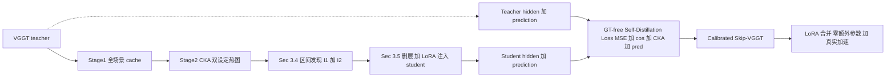

# 视觉几何基础模型的层间冗余分析与 GT-Free 自蒸馏深度压缩

> Inter-Layer Redundancy Analysis and GT-Free Self-Distillation for Depth Compression of Visual Geometry Foundation Models
>
> 投稿意向：NeurIPS 2026（草稿，数值结果以 `TBD` 占位，待最终评测回填）

---

## 摘要

前馈式多视图几何基础模型（如 VGGT）在相机位姿、稠密深度与三维点云任务上达到了强基线，但在长序列、多视角输入下面临显著的显存与延迟压力。现有加速工作（FastVGGT、Faster VGGT、FlashVGGT 等）几乎全部聚焦于 **token 数量** 与 **注意力算子** 层面的冗余，而 **网络深度方向** 是否存在可被系统识别和消除的冗余，仍缺乏与下游几何评测直接对齐的分析与压缩范式。

本文从 **冗余度量** 与 **冗余消除** 两个层面给出系统答案。在度量层面，我们以“实际删除层段后最终预测相对全模型的几何指标退化”为参照，比较线性 CKA、余弦相似度与负均方误差等表征相似性指标，发现 **CKA 与上述任务退化的空间分布模式高度一致**，更适合作为 VGGT 层间冗余的可解释度量；进一步在 ScanNet、7Scenes、NRGBD 三个数据集上比较层间 CKA 热图，发现 **VGGT 的冗余结构在不同数据上几乎一致，表明层间冗余主要由模型本身决定，而非特定数据集分布**。

在消除层面，我们提出一种 **基于阈值与最大面积高相似子区域的冗余层段选取策略**：第一阶段在“帧内子模块与全局子模块可同时视为冗余”的设定下，从层间相似性矩阵中选取覆盖层数最多的连续层段；第二阶段在“仅全局子模块可折叠、帧内子模块保留”的设定下，在排除第一阶段已选层段后的矩阵上继续选取覆盖层数最多的连续层段。随后以完整 VGGT 为教师网络、在选定层段上删除子模块并注入低秩适配（LoRA）的学生网络为对象，进行 **不依赖任何真值标注的自蒸馏较准**：监督信号仅来自教师的中间层表征与最终预测。训练仅需少量无标注多视图场景（本文使用 50 个 ScanNet 场景、50 个训练轮次、仅更新 LoRA 参数）,部署阶段可将 LoRA 权重合并回注意力线性层，**不增加推理期参数量**。相比原始 VGGT，**推理时间降低 TBD%（约 TBD× 加速）**、**峰值显存降低 TBD%**，在 ScanNet、7Scenes、NRGBD 上几何精度与原始模型 **相当**，部分指标 **更优**；本文压缩与 token 级加速正交，实验中还报告了 **以原始 VGGT 为骨干** 与 **在 FastVGGT 的 token 合并骨干上叠加本文删层与较准** 两种实现，以验证二者可组合。

---

## 1. 引言

多视图几何估计已从优化驱动走向 **大规模前馈 Transformer**：以 VGGT [1] 为代表的视觉几何基础模型将相机位姿、稠密深度、三维点云等任务统一为单次前向推理，达到了与传统几何方法竞争甚至更优的精度。VGGT 的聚合器（aggregator）由若干层 **frame block / global block** 交替堆叠组成；其中 global block 的注意力随视角数近似二次增长，使 **长序列与多视角下的显存与延迟** 成为实际部署中的关键瓶颈。

为缓解这一瓶颈，近期一系列工作分别从不同维度切入：**FastVGGT** [2] 利用 attention 中的 token collapse 现象提出 training-free 的 token merging；**Faster VGGT** [3] 用 block-sparse 全局注意力替换稠密算子，无需重训 backbone 即可实现量级推理加速；**FlashVGGT** [4] 引入 descriptor token 与 cross-attention 进一步重构全局推理。可以看出，**token 数量与注意力实现层面的冗余** 已被积极挖掘。但 **深度方向（即 layer 维度）的冗余** 是否存在、能否被系统识别与消除，目前仍缺少与下游几何评测直接对齐的研究。

我们从一个朴素问题出发：**VGGT 这样的多视图几何基础模型，是否每层都同样重要? 用什么指标可以衡量? 发现冗余后如何精简？** 围绕这一问题，本文给出了一条贯穿"度量 → 区间发现 → GT-free 较准"的完整压缩管线。在度量层面，我们以删层后 GT 指标退化为真值，比较了 Linear CKA、cosine 与 −MSE 三种指标，发现 CKA 与真实退化的 **空间分布模式** 高度匹配；并在 ScanNet / 7Scenes / NRGBD 上进一步发现 VGGT 的 CKA 热图几乎完全一致、frame 与 global 的冗余呈现异质模式——这些观察支持"层间冗余是 VGGT 的模型内禀属性"。在消除层面，我们基于"阈值 + 最大面积矩形"识别冗余区间，并提出 **GT-free LoRA 自蒸馏较准**：以原 VGGT 为 teacher，删层 + LoRA 为 student，只用 teacher 输出作为监督，无需任何 GT 标签。

**标志性数字**：以本文 **压缩率较高的一档实验配置** 为例——在连续八层上同时移除帧内与全局子模块，并再在连续六层上仅折叠全局子模块而保留帧内子模块——在与既有工作一致的评测划分及固定帧数输入下，在 ScanNet、7Scenes、NRGBD 三个数据集上：

- 精度与原始 VGGT **相当**，部分指标 **更高**（详见 §4.3 表 4–6）；
- **推理时间相对原 VGGT 降低 TBD% (TBD× speedup)**；
- **峰值显存相对原 VGGT 降低 TBD%**；
- LoRA 训练 **仅 50 ScanNet 场景、50 epoch**、单卡可完成，**完全不使用任何 GT 标签**；
- 部署时 LoRA 合并回原线性权重 ⇒ **与原 VGGT 同参数量**、**层数更少** ⇒ **零额外推理参数**。

**贡献小结**（与正文章节一一对应）：

1. **(Findings, §3.2–§3.3)** CKA 是更贴合任务退化的 VGGT 层间冗余指标；VGGT 层间冗余在三个数据集上呈现几乎一致的 **空间分布模式**，是 **模型内禀属性**，且 frame / global 冗余 **异质**。
2. **(Design, §3.4–§3.5)** "阈值 + 最大面积矩形"两阶段冗余区间发现算法 + **GT-free LoRA 自蒸馏较准**，无需任何 GT 标签、仅 50 场景 50 epoch、仅 LoRA 可训。
3. **(Advantages, §4)** 在 ScanNet / 7Scenes / NRGBD 上精度与原始 VGGT **相当**、部分指标 **更优**；推理时间 ↓ TBD%、峰值显存 ↓ TBD%；零额外推理参数；与 token 级加速正交可组合。

---

## 2. 相关工作

我们以"如何识别冗余"和"如何消除冗余"两条彼此正交的主线组织 Transformer 层级冗余的相关工作（§2.1, §2.2），随后单独综述 **3D 几何基础模型** 的现有压缩工作（§2.3）。完整文献调研见 [docs/paper_related_work.md](docs/paper_related_work.md)。

### 2.1 冗余性识别策略与指标

按"如何发现冗余"的视角，现有工作大致可归为四类：

1. **基于表征 / 层间相似性的识别指标。** 直觉是若一层输入与输出几乎不变、或相邻几层表征高度相似，则该区间存在功能重叠。**ShortGPT** [P-2] 提出 Block Influence (BI)，用层输入输出相似度衡量单层贡献；**LLM-Streamline** [P-3] 使用 hidden-state cosine similarity 定位连续冗余层。更广义地，cosine、CKA、PWCCA、Procrustes、residual change 等表征一致性指标都可纳入这一类。其优点是直观、易做成层间热力图；局限是"表征接近"未必等价于"删除后任务性能不变"。

2. **基于任务性能退化的识别策略。** 不再以表征相似为目标，而直接测量删层后任务指标（如 perplexity、验证集精度、stability）的退化。**SLEB** [P-1] 通过迭代式 block elimination 验证；**BlockPruner** [P-4] 进一步把层内 MHA/MLP 拆开并以 perplexity 作为剪枝准则。这类指标更贴近最终目标，但代价更高，需对每个候选层/区间重复推理。

3. **基于梯度 / 敏感度 / Taylor / Hessian 的重要性估计。** 从优化视角衡量层重要性，常见于通用结构化剪枝文献，能更早反映"该层对损失曲面的敏感度"。

4. **基于结构先验或行为 profiling 的识别方式。** 通过观察推理中的行为规律（attention sparsity、token saliency、跨视角匹配等）识别冗余模块，**ProfilingDiT** [P-5] 是一个边界化但很有启发的例子。

**与本文关系。** 我们 **同时使用前两类**——以 CKA 作为表征指标，以"删层后 GT 几何指标退化"作为性能指标——并首次明确给出 **"以性能退化为真值，比较表征指标谁更可靠"** 的实证结论（§3.2）。这是过往 LLM / ViT 压缩文献中较少被正面回答的问题；在 3D 几何基础模型上，本文是据我们所知首次系统讨论。

### 2.2 冗余性消除与补偿策略

按"识别出冗余后如何处理"，现有工作大致可分为六类：

1. **直接删除 / 恒等跳过 (skip / remove / identity bypass)。** 一旦判定为冗余即删除该层或替换为 `Identity`。**SLEB**、**ShortGPT** 等属于此类。优点是部署简单、加速稳定；缺点是高压缩率下精度下降明显。
2. **轻量替换 (replacement)。** 用更便宜的模块（线性层、低秩 adapter、简化 MLP）近似被删层的功能，如 **LLM-Streamline** 的 layer replacement、**ReplaceMe** [P-6] 的 transformer block linearization。
3. **蒸馏 / 短程恢复 (distillation / recovery)。** 在删层或替换后，通过隐藏状态对齐与最终输出对齐恢复精度；**LLM-Streamline**、**CoMe** [P-7] 与多种自推测解码方法都使用了该思路。这一类通常作为 (1)(2) 的后处理。
4. **层合并 / 层吸收 (merge / collapse)。** 把若干相邻层的功能融合到更少的 block 中，**LaCo** [P-8]、**MKA** [P-9]、**CoMe** 是代表。
5. **重参数化 / Flattening。** **FlattenGPT** [P-10] 将相邻 Transformer block 压平为一个 block，**ReplaceMe** 也属于偏 training-free 的近邻，把"冗余消除"提升为系统性的结构重写。
6. **动态复用 / 缓存式补偿。** 不永久改变结构，而在运行时复用历史特征或缓存中间状态（**ProfilingDiT** 类）。

**与本文关系。** 我们在结构上属于 (1) **直接删除**——区间内 frame / global 块替换为 `SkipIdentityBlock`（[analysis/train/model.py](../analysis/train/model.py)）——但通过 (3) **蒸馏 + LoRA** 进行恢复。LoRA 既是补偿模块，又能在推理期合并回原参数，因此 **同时具备 (1) 的"零额外推理参数"与 (3) 的"精度恢复能力"**。**与现有所有蒸馏式恢复工作不同的是，我们完全不使用 GT 标签，纯用 teacher 输出作为监督**——这一 GT-free 设定显著降低了对标注数据的依赖。

### 2.3 3D Foundation Model 压缩

针对 3D 几何基础模型（VGGT、\(\pi^3\) 等）的压缩研究目前明显少于 LLM 压缩，已有工作大多从 **token 数 / 注意力算子 / 量化** 切入：

- **FastVGGT** [2]：training-free **token merging**，针对 VGGT 长序列下的 token collapse 现象，在多个 3D 几何 benchmark 上验证了 token 侧冗余消除的有效性。
- **Faster VGGT** [3]：**block-sparse global attention**，利用全局注意力中的稀疏结构替换稠密算子，**无需重训 backbone**，报告约 \(4\times\) 量级的推理加速。
- **FlashVGGT** [4]：**compressed descriptor attention**，把每帧空间信息压缩为少量 descriptor token 并支持基于 descriptor cache 的 chunk-recursive 推理。
- **TAPTQ** [5]：**Tail-Aware Post-Training Quantization**，针对 3D 几何模型激活分布尾部更重的特性提出的 PTQ 方法，主要面向部署友好。

**与本文关系。** 上述工作几乎全部聚焦于 **token 数 / 注意力算子 / 量化**，**深度方向 layer-level 压缩在 3D 几何基础模型上仍是空白**。我们填补这条线，且本文方法与上述 token / attention 加速 **正交可组合**。在主表（§4.3）中我们同时报告 **以原始 VGGT 为骨干** 与 **在 FastVGGT 的 token 合并骨干上叠加本文删层与较准** 两种实现，以验证组合性：后者可同时获得 token 侧合并与深度侧删层的收益。

---

## 3. 方法

### 3.1 Preliminaries：VGGT Aggregator

我们以 VGGT-1B 为研究对象。其 aggregator 由 \(L=24\) 层组成，每层包含一个 frame block \(F_\ell\) 和一个 global block \(G_\ell\)，前向递推为：

\[
  h_{\ell+1} = G_\ell\!\big(F_\ell(h_\ell)\big), \quad \ell = 0, 1, \ldots, L-1.
\]

下文的两类"跳过模式"对应代码中的 fusion mode：

- **skip\_both**：在区间 \([i, j]\) 内将 \(F_\ell, G_\ell\) 同时替换为恒等映射，即 \(h_{\ell+1} = h_\ell\)；
- **skip\_global**：仅将 \(G_\ell\) 替换为恒等，保留 \(F_\ell\)；
- 这两种模式下，区间外的层保持原始权重不变。

### 3.2 哪个相似性指标更适合分析 VGGT 层间冗余？

**问题。** 文献中常用的层间相似性指标包括 Linear CKA、cosine similarity、−MSE 等。它们都可以基于 Stage 1 缓存的层边界 hidden state 高效计算（实现见 [analysis/redundancy/analyze_dataset_cache.py](../analysis/redundancy/analyze_dataset_cache.py) 与 [analysis/redundancy/metrics.py](../analysis/redundancy/metrics.py)），并形成上三角热力图 \(M \in \mathbb{R}^{L\times L}\)。但**哪种指标真正反映"删除该区间后任务会退化多少"** 仍然缺少正面对照。

**评判范式。** 我们以"实际跳过"作为真值：对每个区间 \([i, j]\)（\(j-i+1 \le \text{max\_span}\)），调用同一份 Stage 1 缓存做 suffix replay，把区间内对应的 frame / global 块按指定 fusion mode（skip\_both / skip\_global）替换后，前向到 heads，计算最终预测相对全模型的几何指标退化（ATE、ARE、RPE-rot、RPE-trans、Chamfer、depth\_abs\_rel、depth\_δ1）。这一过程在 [analysis/redundancy/analyze_dataset_cache.py](../analysis/redundancy/analyze_dataset_cache.py) 中以 Part B 实现，得到与 \(M\) 同维度的"skip-loss heatmap" \(D\)。

**指标选择标准。** 一个好的相似性指标 \(M\) 应满足：在 \(M\) 中亮（高相似）的区间对应 \(D\) 中暗（低退化）的区间，反之亦然。也即 \(M\) 与 \(D\) 应在 pattern 上高度匹配。

**实证结论。** 我们在 ScanNet 上比较了 CKA / cosine / −MSE 与 \(D\) 的 pattern 相似度（图 1、表 1）：

- **CKA** 与 \(D\) 的 pattern 几乎一致——亮区与暗区位置、形状均高度对应；
- **cosine** 与 \(D\) 的 pattern 偏差显著，亮区分布有明显错位；
- **−MSE** 与 \(D\) 的 pattern 偏差更大，几乎与 \(D\) 不相关。

由此我们将 **CKA** 选为后续区间发现的相似性指标。

> **图 1**（占位）：在 ScanNet 上的六联子图。左列三张：(a) CKA 热图、(b) cosine 热图、(c) −MSE 热图（均为 skip\_both mode 的层间相似性）。右列三张：(d/e/f) 对应同一 mode 下"删除区间 \([i,j]\) 后最终预测的 GT 指标退化"热图（如 ATE 退化）。Caption 强调：(a)↔(d) 几乎重合、(b)↔(e) 明显错位、(c)↔(f) 几乎不相关。
>
> **表 1**（占位）：CKA / cosine / −MSE 与 skip-loss heatmap 在多种几何指标（ATE、ARE、Chamfer、depth\_abs\_rel）上的 pattern 一致性（Pearson \(r\)、Spearman \(\rho\)、NDCG@k）。CKA 在所有列上显著优于 cosine 与 −MSE。
>
> | 相似性指标 | Pearson \(r\) | Spearman \(\rho\) | NDCG@10 |
> | :--- | ---: | ---: | ---: |
> | CKA | TBD | TBD | TBD |
> | cosine | TBD | TBD | TBD |
> | −MSE | TBD | TBD | TBD |

### 3.3 VGGT 层间冗余是模型内禀属性

为验证 §3.2 选出的 CKA 指标所揭示的冗余结构 **不依赖于具体数据集**，我们在 **ScanNet / 7Scenes / NRGBD** 三个数据集上分别用同一份代码（[analysis/redundancy/analyze_dataset_cache.py](../analysis/redundancy/analyze_dataset_cache.py)）计算 patch-token 上的 CKA 矩阵，每数据集报告 **skip\_both** 与 **skip\_global** 两种 mode。

**观察 1：跨数据集一致。** 三个数据集上的 CKA 热图几乎完全相同（图 2 的左、中、右列），无论亮区位置、亮区形状还是相对强度都高度匹配，差异远小于"不同数据集分布差异"所能解释的范围。这说明 **VGGT 的层间冗余结构是模型本身的属性，而不是数据集的特性**。

**观察 2：frame / global 异质冗余。** skip\_both 热图（图 2 顶行）的亮区表示"整层冗余"——即区间内同时跳 frame 与 global 也几乎不影响表征；skip\_global 热图（图 2 底行）在 skip\_both 亮区基础上 **新增** 的亮区，表示"该区间 global block 冗余、frame block 不冗余"——只跳 global 几乎不损失，但若同时跳 frame 则会显著破坏表征。也即 **global block 普遍比 frame block 更冗余**——这也是后续区间发现采用 skip\_both → skip\_global 顺序的物理依据。

> **图 2**（占位）：3 数据集 × 2 mode = 6 张 CKA 热图。
> - 顶行 (a/b/c)：ScanNet / 7Scenes / NRGBD 的 skip\_both CKA。
> - 底行 (d/e/f)：ScanNet / 7Scenes / NRGBD 的 skip\_global CKA。
> Caption：(a)(b)(c) 三张图的 pattern 几乎重合 → 数据无关；(d)(e)(f) 同样高度一致；(d)(e)(f) 相对 (a)(b)(c) 新增的亮区，对应"global 冗余而 frame 重要"的层。

### 3.4 冗余区间发现：阈值 + 最大面积矩形

**形式化定义。** 给定相似性热图 \(M \in \mathbb{R}^{L\times L}\)（这里取 CKA）与阈值 \(\tau\)，二值化得 \(M_\tau = \mathbb{1}[M \ge \tau]\)。在 \(M_\tau\) 中寻找 **最大全 1 区域**：仅画上三角时为 **最大三角形**，三个顶点位于 \((l, l), (r, r), (l, r)\)；画整张时为 **最大正方形 / 矩形**。其对应的 \([l, r]\) 即"最长冗余区间"——选最长以最大化删除层数与参数量；多个等长候选时取区域内 **平均相似度最高** 者。

**两阶段顺序。** 我们按"先整层再 global-only"的物理优先级（§3.3 观察 2）：

- **阶段 1**：在 **skip\_both** 热图 \(M^{\text{both}}\) 上找最长冗余区间 \(I_1 = [l_1, r_1]\)。在 \(I_1\) 上将所有 frame 与 global 块都替换为恒等。
- **阶段 2**：在 **skip\_global** 热图 \(M^{\text{global}}\) 上、**剔除 \(I_1\) 已选位置** 后，找剩余最长冗余区间 \(I_2 = [l_2, r_2]\)。在 \(I_2\) 上仅将 global 块替换为恒等、保留 frame 块。

**算法 1：MaxRedundantInterval & BuildSkipPlan**

```
function MaxRedundantInterval(M, τ, exclude):
    M_τ ← (M ≥ τ)                                    # 二值化
    set entries inside `exclude` to 0                # 排除已选区间
    best_len, best_sim, best_lr ← 0, -∞, None
    for l in 0..L-1:
        for r in l..L-1:
            if all entries M_τ[l..r, l..r] == 1:
                length ← r - l + 1
                avg_sim ← mean(M[l..r, l..r])
                if (length > best_len)
                   or (length == best_len and avg_sim > best_sim):
                    best_len, best_sim, best_lr ← length, avg_sim, (l, r)
    return best_lr

function BuildSkipPlan(M_both, M_global, τ):
    I_1 ← MaxRedundantInterval(M_both,   τ, exclude=∅)
    I_2 ← MaxRedundantInterval(M_global, τ, exclude={I_1})
    return I_1, I_2
```

> **图 3**（占位，**用户后续提供：1 行 4 子图**）：
> - (a) skip\_both CKA 热图。
> - (b) (a) 在阈值 \(\tau\) 下的二值化结果，并用红框标出最大矩形 \(I_1\)。
> - (c) skip\_global CKA 热图。
> - (d) (c) 在阈值 \(\tau\) 下的二值化结果，并用红框标出 **剔除 \(I_1\) 已选位置后** 的最大矩形 \(I_2\)。
> Caption：直观对应算法 1 的两阶段流程——先在“帧内与全局同时可省略”的相似性图上选最长 \(I_1\)，再在“仅全局可折叠”的相似性图上剔除 \(I_1\) 后选剩余最长 \(I_2\)。

**两个工作配置（用于实验）。** 不同阈值 \(\tau\) 给出不同的"压缩-精度"折衷，我们在表 2 中给出常用阈值下的候选区间，并把本文实验所用的两个配置列在最后两行：

> **表 2**（占位）：阈值扫描与本文采用配置。
>
> | 阈值 \(\tau\) | \(I_1\)（第一阶段：帧内与全局子模块同时可省略） | \(I_2\)（第二阶段：仅全局子模块可折叠） | 删除 frame 层 | 删除 global 层 |
> | :--- | :--- | :--- | ---: | ---: |
> | 0.95 | TBD | TBD | TBD | TBD |
> | 0.90（压缩率中等的一档） | [4, 10] (7 层) | [19, 22] (4 层) | 7 | 11 |
> | 0.85（压缩率较高的一档；摘要与 headline 所用） | [4, 11] (8 层) | [18, 23] (6 层) | 8 | 14 |
> | 0.80 | TBD | TBD | TBD | TBD |
>
> 上表两档在实现中对应仓库内的 JSON 区间文件（便于复现）：[中等压缩率档](../analysis/train/config_90_vggt.json)、[较高压缩率档](../analysis/train/config_85_vggt.json)。

### 3.5 GT-Free LoRA 自蒸馏较准

> 本节聚焦 **模型结构、蒸馏目标与设计动机**；具体训练超参（数据规模、epoch、损失权重、显卡等）见 §4.1。

#### 3.5.1 学生模型结构

给定 §3.4 得到的 \((I_1, I_2)\)，我们按以下规则构造 student：

- **删层**：对 \(\ell \in I_1\) 同时将 \(F_\ell, G_\ell\) 替换为 `SkipIdentityBlock`；对 \(\ell \in I_2\) 仅将 \(G_\ell\) 替换为 `SkipIdentityBlock`，保留 \(F_\ell\)（实现见 [analysis/train/model.py](../analysis/train/model.py) 的 `replace_skipped_layers_with_identity`）。
- **LoRA 注入**：在每个区间 **起点的前一层** \(\ell^\star = l - 1\) 的 attention 子模块（`attn.qkv` 与 `attn.proj`）上注入 LoRA（rank \(r\)、scale \(\alpha\)，实现见同文件的 `LoRALinear` 与 `inject_lora_attn`）；如果区间内 frame block 也被 skip，则区间内的 frame attention 也注入；如果区间内 frame block 保留（skip\_global 模式），则该区间内每个 frame 的 attention 同样注入 LoRA，以补偿"上下文中 global 缺失"造成的分布偏移。

正向计算上，被替换为 `SkipIdentityBlock` 的层只把输入直接传到输出；其余层保持原 VGGT 权重，但被注入 LoRA 的 attention 线性变换变为 \(W' x + (B A) x\)（\(W\) 冻结，仅 \(B, A\) 可训）。

#### 3.5.2 教师模型与监督来源

- **Teacher**：原始 VGGT 全模型（24 层完整 aggregator），所有参数冻结；
- **监督来源**：在每个 batch 上 teacher 同样前向，记录两类信号：
  1. **中间层 hidden state** \(\{h^T_\ell\}\)（位置取自删层区间的端点附近，便于与 student 直接对齐）；
  2. **最终预测** \(\hat y^T = (\text{pose\_enc}^T, \text{depth}^T)\)。
- **完全不使用 GT 标签**——任何相机位姿、深度、点云的 ground truth 都不参与损失计算（对应 [analysis/train/train_lora_skip_baseline.py](../analysis/train/train_lora_skip_baseline.py) 的 `--target-source teacher`）。

#### 3.5.3 自蒸馏损失

我们在 student 与 teacher 之间同时对齐 **中间层表征** 与 **最终预测**：

\[
  \mathcal{L}
  = w_{\text{align}} \!\cdot\! \big( w_{\text{mse}}\, \mathcal{L}_{\text{MSE}}
                                   + w_{\cos}\,    \mathcal{L}_{\cos}
                                   + w_{\text{cka}}\, \mathcal{L}_{\text{CKA}} \big)
  + w_{\text{pred}} \!\cdot\! \big( \mathcal{L}_{\text{camera}}(\hat y^S, \hat y^T)
                                  + \mathcal{L}_{\text{depth}}(\hat y^S, \hat y^T) \big),
\]

其中：

- \(\mathcal{L}_{\text{MSE}}, \mathcal{L}_{\cos}, \mathcal{L}_{\text{CKA}}\) 都在 **student / teacher 在同一对齐位置的 hidden state** 上计算，分别对应均方误差、余弦相似（取 \(1 - \cos\)）、Linear CKA（取 \(1 - \text{CKA}\)）；
- \(\mathcal{L}_{\text{camera}}, \mathcal{L}_{\text{depth}}\) 复用 VGGT 训练框架中的相机与深度损失（见 [analysis/loss.py](../analysis/loss.py) 的 `compute_camera_loss` / `compute_depth_loss`），但 **target 不再是 GT 而是 teacher 的 \(\hat y^T\)**；这一替换是 GT-free 设定的关键。

#### 3.5.4 设计要点与亮点

- **GT-free**：训练目标只来自 teacher 输出 → 不依赖任何 ground truth 标签，理论上可在任何无标注多视图集合上扩展；从工程上避免了为新场景准备 GT 的高昂代价。
- **极少训练样本与代价**：teacher 自身已是强模型，少量场景即可让 student 复现 teacher 行为。本文仅使用 50 个 ScanNet 场景、训练 50 epoch（具体超参见 §4.1）。
- **仅 LoRA 可训**：参数高效，训练显存与 wall-clock 都极低；teacher 与 student 共享 \(>\)99% 的权重 → 训练侧无需保存第二份大模型。
- **LoRA 可合并 → 零额外推理参数**：部署时令 \(W' \leftarrow W + B A\)，与原 VGGT 同参数量；同时层数减少 \(|I_1| + |I_2|\) ⇒ **真实推理加速 (TBD%) + 显存下降 (TBD%)**。

#### 3.5.5 整体管线图



> **图 4**（占位，**用户后续提供：2 行网络结构示意**）：
> - 第 1 行：**skip\_both mode** 区间 \(I_1\)——展示原本的 frame+global 序列被替换为 Identity，前一层 attn 上挂 LoRA；标注 hidden state 对齐位置（区间端点）与 prediction 对齐位置（heads 之后）。
> - 第 2 行：**skip\_global only mode** 区间 \(I_2\)——展示 frame block 保留、global block 被替换为 Identity，前一层 attn + 区间内每个 frame attn 上挂 LoRA；同样标注两类对齐位置。
> - 整图右侧汇合处显示 **teacher 路径 (灰色)** 与 **student 路径 (彩色)**，红色虚线指向蒸馏 loss 节点。

---

## 4. 实验

### 4.1 实验设定

#### 4.1.1 数据

- **Calibration（训练）数据**：50 个 ScanNet 场景（`data/scans_dev50`）。**目标只用 teacher 输出**，对应 `--target-source teacher` ⇒ 全程 **GT-free / self-distillation**。
- **测试数据**（与 FastVGGT 评测协议对齐，脚本见 [run_eval.sh](../run_eval.sh)）：
  - **ScanNet**：另 50 个场景（`data/scans_test50`），`input_frame=50`；
  - **7Scenes**：`kf=10`、`size=518`，按 [eval_7andN.py](../analysis/eval/eval_7andN.py) 协议；
  - **NRGBD**：与 7Scenes 相同协议。

#### 4.1.2 训练超参

- **优化器**：AdamW，`lr=3e-5`、`weight_decay=0.05`、`min_lr=1e-8`、`warmup_ratio=0.05`、`grad_clip_max_norm=1.0`；
- **训练规模**：`epochs=50`，`max_scenes=50`（仅 ScanNet `scans_dev50`）；
- **LoRA**：`rank=8`、`alpha=16`、`dropout=0`；
- **损失权重**（与表 2 两档默认实验 JSON 中设定一致，见 [较高压缩率档](../analysis/train/config_85_vggt.json)、[中等压缩率档](../analysis/train/config_90_vggt.json)）：\(w_{\text{align}} = w_{\text{mse}} = w_{\cos} = w_{\text{cka}} = w_{\text{pred}} = w_{\text{camera}} = w_{\text{depth}} = 1.0\)；
- **target source**：`teacher` ⇒ GT-free；
- **数值精度**：bfloat16 混合精度 + activation checkpointing。

#### 4.1.3 硬件与可训参数

- **硬件**：单卡 NVIDIA TBD（如 A100 80G 或 RTX 4090 24G）；
- **可训参数比例**：trainable / total ≈ TBD%（仅 LoRA 注入位置的 \(B, A\)）；
- **训练时间**：单卡 wall-clock ≈ TBD 小时 / 50 epoch。

#### 4.1.4 评测指标与口径

- **ScanNet**：Chamfer 距离、ATE、ARE、RPE-rot、RPE-trans、`depth_abs_rel`、`depth_δ1`、`inference_time(ms)`、`peak_GPU_mem(GB)`；
- **7Scenes / NRGBD**：`acc`、`comp`、`nc`、`acc_med`、`comp_med`、`nc_med`、`inference_time(ms)`、`peak_GPU_mem(GB)`；
- **效率测量协议**：固定 batch、固定 input\_frame，warmup 3 次后取 10 次平均；显存以 `torch.cuda.max_memory_allocated` 为准。

### 4.2 对比方法

每张主表都列出以下行：

- **VGGT**：原始预训练模型，全 24 层 aggregator；
- **VGGT skip-only（较高压缩率档）** / **VGGT skip-only（中等压缩率档）**：与表 2 中两档层段选取一致地删层但 **不做任何较准**——用以衡量"删层造成的最大可能精度下降"，对应评测脚本中仅应用删层、不加载 LoRA 权重的 lower bound；
- **FastVGGT** [2]：token merging（强 token 侧加速基线）；
- **本文较准（中档，VGGT）/ 本文较准（高档，VGGT）**：以原始 VGGT 为骨干，在表 2 对应层段上删子模块并做 LoRA 自蒸馏较准；
- **本文较准（中档，FastVGGT）/ 本文较准（高档，FastVGGT）**：在 FastVGGT 骨干上叠加相同删层与较准 ⇒ 同时享受 token merging 与深度侧删层，验证 **正交可组合性**。

### 4.3 主结果

> 每张主表的 caption 都附带一句"**在压缩率较高一档下，本文较准模型相对原始 VGGT：推理时间下降 TBD%、峰值显存下降 TBD%，精度与原始模型相当或更优**"。

**表 4**：ScanNet (`scans_test50`, `input_frame=50`) 主表。

| Method | Chamfer ↓ | ATE ↓ | ARE ↓ | RPE-rot ↓ | RPE-trans ↓ | depth\_abs\_rel ↓ | depth\_δ1 ↑ | time(ms) ↓ | peak mem(GB) ↓ |
| :--- | ---: | ---: | ---: | ---: | ---: | ---: | ---: | ---: | ---: |
| VGGT | TBD | TBD | TBD | TBD | TBD | TBD | TBD | TBD | TBD |
| VGGT 仅删层（中档） | TBD | TBD | TBD | TBD | TBD | TBD | TBD | TBD | TBD |
| VGGT 仅删层（高档） | TBD | TBD | TBD | TBD | TBD | TBD | TBD | TBD | TBD |
| FastVGGT | TBD | TBD | TBD | TBD | TBD | TBD | TBD | TBD | TBD |
| **本文较准（中档，VGGT）** | TBD | TBD | TBD | TBD | TBD | TBD | TBD | TBD | TBD |
| **本文较准（中档，FastVGGT）** | TBD | TBD | TBD | TBD | TBD | TBD | TBD | TBD | TBD |
| **本文较准（高档，VGGT）** | TBD | TBD | TBD | TBD | TBD | TBD | TBD | TBD | TBD |
| **本文较准（高档，FastVGGT）** | TBD | TBD | TBD | TBD | TBD | TBD | TBD | TBD | TBD |

**表 5**：7Scenes 主表。

| Method | acc ↓ | comp ↓ | nc ↑ | acc\_med ↓ | comp\_med ↓ | nc\_med ↑ | time(ms) ↓ | peak mem(GB) ↓ |
| :--- | ---: | ---: | ---: | ---: | ---: | ---: | ---: | ---: |
| VGGT | TBD | TBD | TBD | TBD | TBD | TBD | TBD | TBD |
| VGGT 仅删层（中档） | TBD | TBD | TBD | TBD | TBD | TBD | TBD | TBD |
| VGGT 仅删层（高档） | TBD | TBD | TBD | TBD | TBD | TBD | TBD | TBD |
| FastVGGT | TBD | TBD | TBD | TBD | TBD | TBD | TBD | TBD |
| **本文较准（中档，VGGT）** | TBD | TBD | TBD | TBD | TBD | TBD | TBD | TBD |
| **本文较准（中档，FastVGGT）** | TBD | TBD | TBD | TBD | TBD | TBD | TBD | TBD |
| **本文较准（高档，VGGT）** | TBD | TBD | TBD | TBD | TBD | TBD | TBD | TBD |
| **本文较准（高档，FastVGGT）** | TBD | TBD | TBD | TBD | TBD | TBD | TBD | TBD |

**表 6**：NRGBD 主表（行结构同表 5）。

| Method | acc ↓ | comp ↓ | nc ↑ | acc\_med ↓ | comp\_med ↓ | nc\_med ↑ | time(ms) ↓ | peak mem(GB) ↓ |
| :--- | ---: | ---: | ---: | ---: | ---: | ---: | ---: | ---: |
| VGGT | TBD | TBD | TBD | TBD | TBD | TBD | TBD | TBD |
| VGGT 仅删层（中档） | TBD | TBD | TBD | TBD | TBD | TBD | TBD | TBD |
| VGGT 仅删层（高档） | TBD | TBD | TBD | TBD | TBD | TBD | TBD | TBD |
| FastVGGT | TBD | TBD | TBD | TBD | TBD | TBD | TBD | TBD |
| **本文较准（中档，VGGT）** | TBD | TBD | TBD | TBD | TBD | TBD | TBD | TBD |
| **本文较准（中档，FastVGGT）** | TBD | TBD | TBD | TBD | TBD | TBD | TBD | TBD |
| **本文较准（高档，VGGT）** | TBD | TBD | TBD | TBD | TBD | TBD | TBD | TBD |
| **本文较准（高档，FastVGGT）** | TBD | TBD | TBD | TBD | TBD | TBD | TBD | TBD |

### 4.4 消融

**表 7**（消融 1：相似性指标 → 区间 → 训练效果）。在同一管线下，分别用 CKA / cosine / −MSE 推得的两阶段区间执行 GT-free LoRA 自蒸馏较准，对比 ScanNet 主指标 + 推理时间。预期 CKA 显著优。

| 区间发现指标 | Chamfer ↓ | ATE ↓ | RPE-trans ↓ | depth\_abs\_rel ↓ | time(ms) ↓ |
| :--- | ---: | ---: | ---: | ---: | ---: |
| CKA (ours) | TBD | TBD | TBD | TBD | TBD |
| cosine | TBD | TBD | TBD | TBD | TBD |
| −MSE | TBD | TBD | TBD | TBD | TBD |

**表 8**（消融 2：损失项消融）。逐一 / 组合开关 `align_mse`、`align_cos`、`align_cka`、`pred` 四项。

| MSE | cos | CKA | pred | Chamfer ↓ | ATE ↓ | depth\_abs\_rel ↓ |
| :---: | :---: | :---: | :---: | ---: | ---: | ---: |
| ✓ | | | | TBD | TBD | TBD |
| | ✓ | | | TBD | TBD | TBD |
| | | ✓ | | TBD | TBD | TBD |
| | | | ✓ | TBD | TBD | TBD |
| ✓ | ✓ | ✓ | | TBD | TBD | TBD |
| ✓ | ✓ | ✓ | ✓ (ours) | TBD | TBD | TBD |

**表 9**（消融 3：LoRA rank、训练 epoch、训练场景数）。

| LoRA rank | epoch | scenes | Chamfer ↓ | ATE ↓ | trainable params (M) |
| :---: | :---: | :---: | ---: | ---: | ---: |
| 4 | 50 | 50 | TBD | TBD | TBD |
| **8 (ours)** | **50** | **50** | TBD | TBD | TBD |
| 16 | 50 | 50 | TBD | TBD | TBD |
| 8 | 10 | 50 | TBD | TBD | TBD |
| 8 | 30 | 50 | TBD | TBD | TBD |
| 8 | 50 | 10 | TBD | TBD | TBD |
| 8 | 50 | 25 | TBD | TBD | TBD |

> **图 5**（占位）：训练曲线——dev / test 上的 ATE / RPE / Chamfer / depth\_abs\_rel 随 epoch 变化（直接复用 [analysis_outputs/lora_skip/config_90_vggt/eval_plot_scannet_ate.png](../analysis_outputs/lora_skip/config_90_vggt/eval_plot_scannet_ate.png) 等已生成的图）。结论：50 epoch 已收敛；少量训练即可让 student 接近 teacher。

### 4.5 推理效率与显存

> **图 6**（占位）：`input_frame ∈ {30, 50, 100, 200, 500}` 下，各方法的 (a) 推理时间、(b) 峰值显存折线图；x 轴为 `input_frame`，y 轴对数刻度。曲线包括 VGGT、FastVGGT、以及表 4 所列本文较准的中档与高档两行（VGGT 与 FastVGGT 骨干各一）。

文字结论：

- 长序列下 layer-skip 的 **绝对** 时间 / 显存收益随 `input_frame` 增长而扩大；
- 与 FastVGGT 组合时收益叠加，证明本文方法与 token 级加速 **正交**；
- 较高压缩率档位比较激进的一档在效率上收益更大、精度上略低于压缩率中等的一档 ⇒ 给出"压缩-精度"折衷的两个工作点。

### 4.6 可训参数与部署期参数对比

> **表 10**（占位）：训练期 trainable / 部署期 effective 参数对比。

| Stage | LoRA 是否合并 | 总参数 (M) | 可训参数 (M) | 比例 |
| :--- | :---: | ---: | ---: | ---: |
| Training | 未合并 | TBD | TBD | TBD% |
| Inference (Ours) | 合并 \(W \leftarrow W + BA\) | **= 原 VGGT 参数量** | 0 | 0% |

凸显本文 **零额外推理参数** 的卖点：训练期需要存 LoRA 的 \(B, A\)，部署期一次性合并后即与原 VGGT 同参数量、但层数更少。

---

## 5. 讨论与局限

- **效率 / 精度 Pareto 前沿**：本文给出压缩率较高与中等两档工作点；阈值 \(\tau\) 连续扫描可生成完整 Pareto 前沿（留作工程化补充）。
- **阈值选择**：当前 \(\tau\) 由阈值扫描手工确定，未来可由验证集 ATE 早停自动化。
- **backbone 通用性**：本文仅在 VGGT-1B 验证，更大或更小 backbone（如 \(\pi^3\)）有待评测。
- **GT-free 的边界**：理论上可扩展到任意无标注多视图集合；本文受时间限制只验证了 ScanNet 50 场景，更大规模 calibration 是否带来增益未充分探索。
- **与 Faster VGGT / FlashVGGT 的联合部署**：本文已验证与 FastVGGT 的组合，但与 Faster VGGT、FlashVGGT 的联合部署未实测，留待工程化补充。

---

## 6. 结论

本文针对视觉几何基础模型 VGGT，给出了一条贯穿"度量 → 区间发现 → GT-free 较准"的层级压缩管线。在度量层面，我们以"删层后任务退化"为真值，证明 **CKA 是更可靠的层间冗余指标**，并发现 **VGGT 的层间冗余是模型内禀属性**（跨数据集分布模式一致、frame / global 异质冗余）；在消除层面，我们提出 **阈值 + 最大面积矩形** 的两阶段冗余区间发现算法，以及 **GT-free LoRA 自蒸馏较准**——以原 VGGT 为 teacher，仅用 50 个 ScanNet 场景、50 epoch、仅 LoRA 可训、且 **完全不使用任何 GT 标签**——即可让 student 在几何指标上与 teacher **相当**。在 **压缩率较高的一档** 下，**推理时间下降 TBD%、峰值显存下降 TBD%、零额外推理参数**，并在 ScanNet / 7Scenes / NRGBD 上保持与原 VGGT **相当**、部分指标 **更优**。本方法与 token 级加速（FastVGGT 等）**正交可组合**，为 3D 几何基础模型的轻量化部署提供了一个互补的"深度方向"切入点。

---

## 参考文献

> 完整参考文献与链接见 [docs/paper_related_work.md](docs/paper_related_work.md)；正文引用编号采用 `[#]` 占位，定稿时统一为 BibTeX 格式。

**3D 几何基础模型与加速**

[1] Wang et al. *VGGT: Visual Geometry Grounded Transformer.* CVPR 2025.
[2] Shen et al. *FastVGGT: Training-Free Acceleration of Visual Geometry Transformer.* [arXiv:2509.02560](https://arxiv.org/abs/2509.02560)
[3] Wang et al. *Faster VGGT with Block-Sparse Global Attention.* [arXiv:2509.07120](https://arxiv.org/abs/2509.07120)
[4] *FlashVGGT: Efficient and Scalable Visual Geometry Transformers with Compressed Descriptor Attention.* [arXiv:2512.01540](https://arxiv.org/abs/2512.01540)
[5] *TAPTQ: Tail-Aware Post-Training Quantization for 3D Geometry Models.* (链接见 paper\_related\_work)

**Transformer 层级冗余识别 / 消除**

[P-1] *SLEB: Streamlining LLMs through Redundancy Verification and Elimination of Transformer Blocks.* ICML 2024.
[P-2] *ShortGPT: Layers in Large Language Models are More Redundant Than You Expect.* Findings of ACL 2025.
[P-3] *LLM-Streamline: Streamlining Redundant Layers to Compress Large Language Models.* ICLR 2025. [arXiv:2403.19135](https://arxiv.org/abs/2403.19135)
[P-4] *BlockPruner: Fine-grained Pruning for LLMs.* Findings of ACL 2025.
[P-5] *ProfilingDiT: Profiling-aware Diffusion Transformer Acceleration.* ICCV 2025.
[P-6] *ReplaceMe: Linear Transformation Replacement for Transformer Blocks.* NeurIPS 2025.
[P-7] *CoMe: Layer as Puzzle Pieces.*
[P-8] *LaCo: Large Language Model Pruning via Layer Collapse.* Findings of EMNLP 2024.
[P-9] *MKA: Manifold-Knowledge-Aware Layer Merging.* EMNLP 2024.
[P-10] *FlattenGPT: Flatten then Prune.*

更完整的相关工作（含 LayerSkip、EE-LLM、Kangaroo、CAS-Spec、ADEPT、MoR、ITT、PPCL、GitMerge3D 等）见 [docs/paper_related_work.md](docs/paper_related_work.md)。

---

## 附录（占位）

- **A. 完整热图汇总**：CKA / cosine / −MSE / skip-loss heatmap（每数据集 × 每 mode × 每 GT 指标）。
- **B. 训练超参与 LoRA 注入位置完整清单**：列出每条 interval rule、对应 LoRA 注入的 frame/global 索引、可训参数精确数。
- **C. 每个数据集 / 每个方法的 per-scene 数值表**。
- **D. 失败案例 / 极端长序列分析**（`input_frame ≥ 500`，是否存在累积偏差等）。
- **E. 部署细节**：LoRA 合并的等价性证明、推理路径示意、量化兼容性讨论。

---

## 图 / 表清单

- **图 1**（§3.2）：CKA / cos / −MSE 热图 vs skip-loss 退化热图（六联子图）。
- **图 2**（§3.3）：3 数据集 × 2 mode CKA 热图（六联）。
- **图 3**（§3.4，**用户后续提供**）：区间发现 4 子图——skip\_both 热图 / 阈值化+矩形 \(I_1\) / skip\_global 热图 / 阈值化+矩形 \(I_2\)。
- **图 4**（§3.5，**用户后续提供**）：网络结构 + 蒸馏目标示意 2 行——skip\_both / skip\_global only。
- **图 5**（§4.4）：训练曲线（直接复用 `analysis_outputs/lora_skip/config_90_vggt/eval_plot_*.png`）。
- **图 6**（§4.5）：长序列推理时间 / 显存折线。
- **表 1**（§3.2）：相似性指标 vs skip-loss pattern 一致性。
- **表 2**（§3.4）：阈值扫描下的区间候选与删除层数。
- **表 4 / 5 / 6**（§4.3）：ScanNet / 7Scenes / NRGBD 主结果。
- **表 7 / 8 / 9**（§4.4）：相似性指标 / 损失项 / LoRA 与训练规模 消融。
- **表 10**（§4.6）：训练期 vs 部署期参数对比，凸显零额外推理参数。
